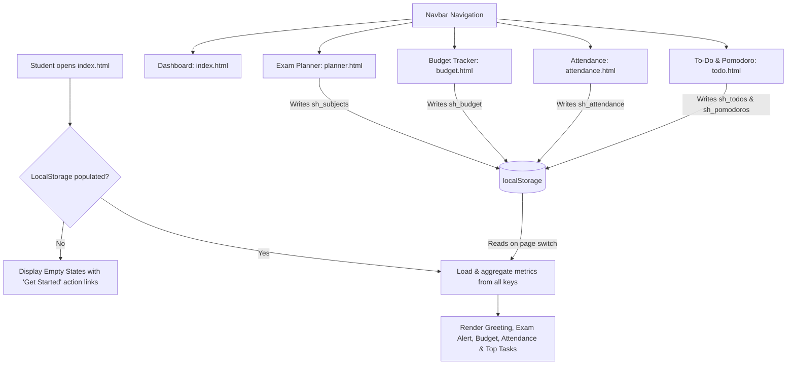
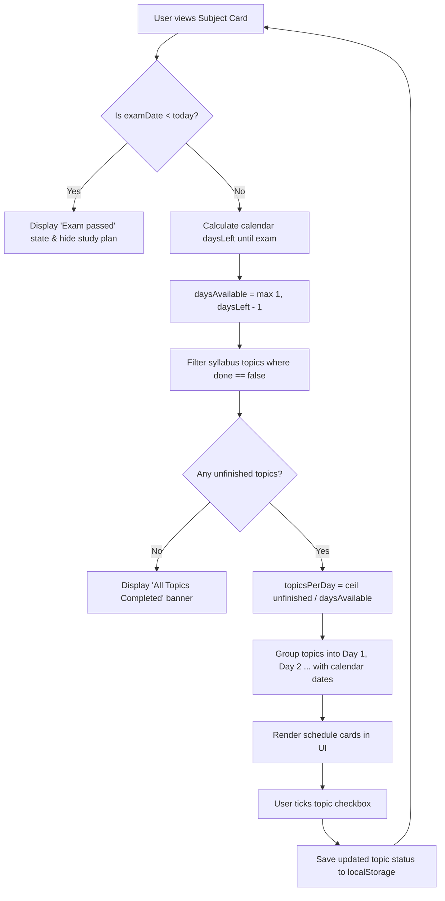
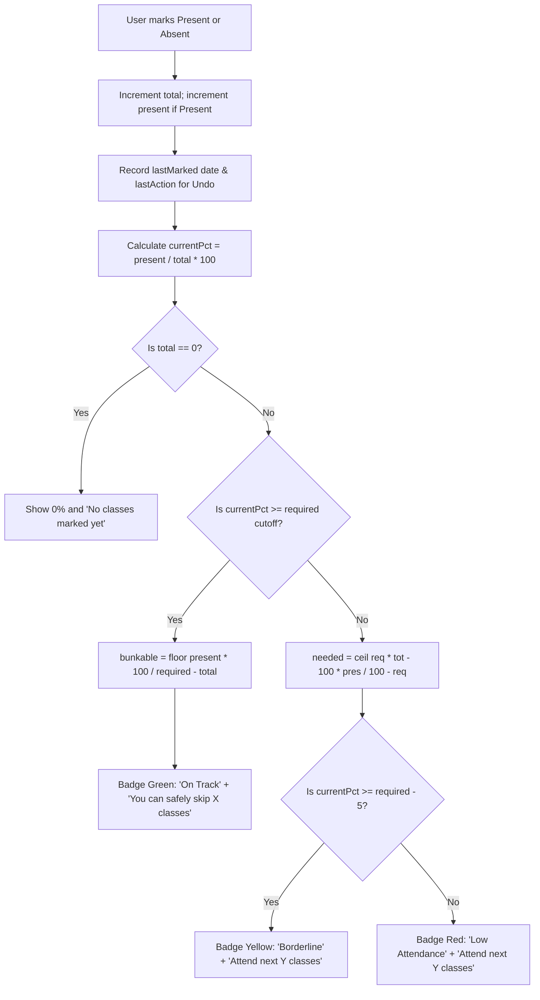

# StudentHub — College Mini-Project Evaluation Report Notes

**Course / Evaluation**: 1st-Year B.Tech Web Development Mini-Project  
**Project Title**: StudentHub — Offline Student Productivity Platform  
**Architecture**: 100% Client-Side Single-Device Web Architecture (Vanilla HTML5, CSS3, JavaScript ES6)  
**Storage**: HTML5 `localStorage` (Offline-first, zero cloud dependencies)

---

## 1. Module Overview
| # | Module | One-Line Description |
|---|---|---|
| 1 | **Dashboard** (`index.html`) | Executive single-screen summary pulling live metrics from exams, budget, attendance, and tasks. |
| 2 | **Exam Planner** (`planner.html`) | Subject syllabus tracking with an algorithmic day-wise study schedule generator. |
| 3 | **Budget Tracker** (`budget.html`) | Student allowance management with safe daily spending limits and pure CSS proportional bar charts. |
| 4 | **Attendance Tracker** (`attendance.html`) | Course attendance logger providing smart formulas for safe class skips and recovery targets. |
| 5 | **To-Do & Pomodoro** (`todo.html`) | Two-tier prioritized task checklist paired with a distraction-free Web Audio Pomodoro study timer. |

---

## 2. LocalStorage Schema & Data Structures
All data persistence is managed through `js/storage.js` using strict try/catch error boundaries.

| Key | Data Type | Schema / Shape | Description |
|---|---|---|---|
| `sh_subjects` | `Array<Object>` | `[{ id: string, name: string, examDate: string, topics: [{ id: string, title: string, done: boolean }] }]` | List of enrolled academic subjects, exam deadlines ("YYYY-MM-DD"), and syllabus topics with completion status. |
| `sh_budget` | `Object` | `{ month: string, allowance: number, expenses: [{ id: string, amount: number, category: string, date: string, note: string }], history: [{ month: string, allowance: number, spent: number }] }` | Current active month ("YYYY-MM"), set allowance, list of logged expenses, and historical monthly summaries. |
| `sh_attendance` | `Array<Object>` | `[{ id: string, name: string, required: number, present: number, total: number, lastMarked: string, lastAction: string }]` | Course-wise attendance records, minimum required percentage (default 75%), attendance tally, and undo action tracking. |
| `sh_todos` | `Array<Object>` | `[{ id: string, text: string, priority: "High"\|"Medium"\|"Low", due: string\|null, done: boolean }]` | Student assignments and personal tasks with priority weightings and optional deadlines. |
| `sh_pomodoros` | `Object` | `{ date: string, count: number }` | Daily tally of completed 25-minute Pomodoro focus intervals for the current date ("YYYY-MM-DD"). |
| `sh_theme` | `string` | `"light" \| "dark"` | User interface theme preference applied via the `data-theme` document root attribute. |

---

## 3. Algorithm Specifications & Time Complexity Analysis
Each algorithmic calculation is implemented as an isolated, deterministic function with dedicated documentation comments.

| Algorithm Name | File Location | Function Name | Core Mathematical Formula | Time Complexity | Space Complexity |
|---|---|---|---|---|---|
| **Study Plan Distribution** | `js/planner.js` / `js/common.js` | `calculateStudyPlanDistribution(unfinishedCount, daysAvailable)` | $\lceil \frac{\text{unfinished}}{\text{daysAvailable}} \rceil$ | $O(1)$ | $O(1)$ |
| **Daily Safe-to-Spend** | `js/budget.js` / `js/common.js` | `calculateSafeToSpend(remainingAmount, daysLeftInMonth)` | $\lfloor \frac{\text{remaining}}{\text{daysLeftInMonth}} \rfloor$ | $O(1)$ | $O(1)$ |
| **Attendance Skip Calculator** | `js/attendance.js` / `js/common.js` | `calculateClassesCanSkip(present, total, required)` | $\lfloor \frac{\text{present} \times 100}{\text{required}} - \text{total} \rfloor$ | $O(1)$ | $O(1)$ |
| **Attendance Recovery Calculator** | `js/attendance.js` / `js/common.js` | `calculateClassesToAttend(present, total, required)` | $\lceil \frac{\text{required} \times \text{total} - 100 \times \text{present}}{100 - \text{required}} \rceil$ | $O(1)$ | $O(1)$ |
| **Two-Tier Task Sorting** | `js/todo.js` / `js/common.js` | `sortTasksByPriorityAndDate(tasks)` | Priority weight descending ($3 > 2 > 1$) then Due date ascending | $O(N \log N)$ | $O(N)$ |
| **Days-Left Countdown** | `js/storage.js` / `js/common.js` | `calculateDaysLeft(fromDateStr, targetDateStr)` | $\text{round}\left(\frac{\text{targetMidnight} - \text{fromMidnight}}{86,400,000}\right)$ | $O(1)$ | $O(1)$ |
| **Pomodoro Countdown Step** | `js/todo.js` / `js/common.js` | `calculatePomodoroTimerStep(remainingSeconds)` | $\lfloor \frac{s}{60} \rfloor : (s \pmod{60})$ | $O(1)$ | $O(1)$ |
| **Category Expense Percentage** | `js/budget.js` / `js/common.js` | `calculateCategoryPercentages(expenses, categories)` | $\text{round}\left(\frac{\sum \text{catAmount}}{\text{totalSpent}} \times 100\right)$ | $O(N + C)$ | $O(C)$ |

---

## 4. Requirements Traceability Matrix (PRD vs. Implementation)

| PRD Section | Requirement Description | Implementing File | Implementing Function / Component | Verification Status |
|---|---|---|---|---|
| **PRD §2** | Shared Navbar with theme toggle & mobile collapse | `index.html`, `css/style.css`, `js/common.js` | `initTheme()`, `initHamburgerMenu()`, `highlightActiveNavLink()` | Verified |
| **PRD §3.1** | Dynamic greeting by time of day & date | `js/dashboard.js` | `renderGreeting()` | Verified |
| **PRD §3.1** | Next exam countdown card (&le; 3 days red) | `js/dashboard.js` | `renderExamCard()` | Verified |
| **PRD §3.1** | Monthly budget progress & safe-to-spend card | `js/dashboard.js` | `renderMoneyCard()` | Verified |
| **PRD §3.1** | Lowest attendance course warning card | `js/dashboard.js` | `renderAttendanceCard()` | Verified |
| **PRD §3.1** | Top 3 pending tasks sorted by priority | `js/dashboard.js` | `renderTasksCard()` | Verified |
| **PRD §3.1** | Demo data loader & data reset | `js/dashboard.js` | `loadDemoData()`, `clearAllData()` | Verified |
| **PRD §3.2** | Add subject with validation (no past exam dates) | `js/planner.js` | `setupAddSubjectForm()`, `initExamDateMin()` | Verified |
| **PRD §3.2** | Topic checklist with live progress bar | `js/planner.js` | `renderSubjectCard()`, `toggleTopicDone()` | Verified |
| **PRD §3.2** | Auto-generate study plan distributed over days | `js/planner.js` | `generateStudyPlanHTML()`, `calculateStudyPlanDistribution()` | Verified |
| **PRD §3.2** | Study plan rescheduling & past exam state | `js/planner.js` | `bindSubjectEvents()`, `renderSubjectCard()` | Verified |
| **PRD §3.3** | Set allowance & automatic month rollover | `js/budget.js` | `checkMonthRollover()`, `promptSetAllowance()` | Verified |
| **PRD §3.3** | Safe to spend per day calculation | `js/budget.js` | `calculateSafeToSpend()`, `renderBudgetModule()` | Verified |
| **PRD §3.3** | 80% and 100% budget warning alert banners | `js/budget.js` | `renderWarningBanner()` | Verified |
| **PRD §3.3** | Pure CSS category proportion chart | `js/budget.js`, `css/style.css` | `renderCategoryChart()`, `calculateCategoryPercentages()` | Verified |
| **PRD §3.3** | Monthly history archive table | `js/budget.js` | `renderMonthHistory()` | Verified |
| **PRD §3.4** | Add course with customizable required cutoff % | `js/attendance.js` | `setupAddAttendanceForm()` | Verified |
| **PRD §3.4** | Mark Present / Absent and Undo last action | `js/attendance.js` | `markAttendance()`, `undoLastMark()` | Verified |
| **PRD §3.4** | Smart skip & recovery guidance messages | `js/attendance.js` | `calculateClassesCanSkip()`, `calculateClassesToAttend()` | Verified |
| **PRD §3.4** | Overall aggregate attendance across all courses | `js/attendance.js` | `renderOverallStats()` | Verified |
| **PRD §3.5** | Add task with Priority (High/Med/Low) & Due date | `js/todo.js` | `setupTaskEventListeners()` | Verified |
| **PRD §3.5** | Task filters (All / Pending / Done) & Clear completed | `js/todo.js` | `renderTasksList()`, `setupTaskEventListeners()` | Verified |
| **PRD §3.5** | Overdue task indicator | `js/todo.js` | `renderTasksList()` | Verified |
| **PRD §3.5** | Pomodoro 25m Focus / 5m Break timer | `js/todo.js` | `initPomodoroTimer()`, `switchPomodoroMode()` | Verified |
| **PRD §3.5** | Web Audio API completion chime | `js/todo.js` | `playPomodoroChime()` | Verified |
| **PRD §3.5** | Daily completed Pomodoro counters | `js/todo.js`, `js/dashboard.js` | `handlePomodoroSessionComplete()`, `renderPomodoroTodayCount()` | Verified |
| **PRD §4** | Safe localStorage abstraction & fallback | `js/storage.js` | `getData()`, `setData()` | Verified |
| **Design** | Dark / Light theme persistence with CSS variables | `css/style.css`, `js/common.js` | `initTheme()`, `applyTheme()` | Verified |

---

## 5. Test Case Verification Table
The built-in test suite in `js/tests.js` tests these exact cases automatically upon clicking **"Run self-tests"** on the dashboard.

| Test ID | Module Tested | Input Vector | Expected Output | Actual Behavior | Pass/Fail |
|---|---|---|---|---|---|
| **TC-01** | Attendance Skip | `present: 0, total: 0, required: 75` | `0` skips | Safely handles 0 classes without division by zero | ✅ PASS |
| **TC-02** | Attendance Skip | `present: 10, total: 10, required: 75` | `3` skips | $\lfloor \frac{1000}{75} - 10 \rfloor = \lfloor 13.33 - 10 \rfloor = 3$ | ✅ PASS |
| **TC-03** | Attendance Skip | `present: 15, total: 20, required: 75` | `0` skips | Exactly at 75%, 0 classes can be skipped | ✅ PASS |
| **TC-04** | Attendance Recovery | `present: 5, total: 10, required: 75` | `10` classes | $\lceil \frac{750 - 500}{25} \rceil = \lceil 10 \rceil = 10$ consecutive classes | ✅ PASS |
| **TC-05** | Attendance Recovery | `present: 8, total: 10, required: 75` | `0` classes | Already at 80% (&ge; 75%), returns 0 | ✅ PASS |
| **TC-06** | Days-Left Countdown | `from: "2026-10-25", to: "2026-10-26"` | `1` day | Correctly calculates 1 calendar day remaining | ✅ PASS |
| **TC-07** | Days-Left Countdown | `from: "2026-10-25", to: "2026-10-25"` | `0` days | Returns 0 for exam scheduled today | ✅ PASS |
| **TC-08** | Days-Left Countdown | `from: "2026-10-25", to: "2026-10-22"` | `-3` days | Returns negative integer for past exam dates | ✅ PASS |
| **TC-09** | Safe-to-Spend | `remaining: 3000, daysLeft: 10` | `300` | $\lfloor \frac{3000}{10} \rfloor = 300$ ₹/day safe limit | ✅ PASS |
| **TC-10** | Safe-to-Spend | `remaining: -450, daysLeft: 5` | `0` | Overspent balance safely clamped to 0 ₹/day | ✅ PASS |
| **TC-11** | Study Plan Dist. | `unfinished: 7, daysAvailable: 3` | `3` topics/day | $\lceil \frac{7}{3} \rceil = 3$ topics scheduled per day | ✅ PASS |
| **TC-12** | Study Plan Dist. | `unfinished: 0, daysAvailable: 4` | `0` topics/day | 0 unfinished topics returns 0 per day | ✅ PASS |
| **TC-13** | Task Priority Sorting | 4 tasks with mixed priorities & due dates | High > Med > Low, earlier due first | Tasks cleanly ordered; completed tasks pushed to bottom | ✅ PASS |
| **TC-14** | Pomodoro Step | `remainingSeconds: 1500` | `"25:00"` | Properly zero-pads minutes and seconds display | ✅ PASS |
| **TC-15** | Pomodoro Step | `remainingSeconds: 0` | `isFinished: true` | Flags timer completion at 0 seconds | ✅ PASS |
| **TC-16** | Category Chart | `Food: ₹1000, Travel: ₹1000, Total: ₹2000` | `{ food: 50%, travel: 50% }` | Proportional category distribution accurately computed | ✅ PASS |

---

## 6. Architecture & Process Flowcharts (Mermaid Syntax)

### Flowchart 1: Overall Navigation & Data Flow

### Flowchart 2: Exam Study Plan Generation Flow

### Flowchart 3: Course Attendance Calculation & Hint Logic

---

## 7. System Limitations
1. **Single-Device Isolation**: Because all data is stored inside browser `localStorage`, entries created on a laptop will not automatically sync to a phone or tablet.
2. **No Background Push Notifications**: Web notifications cannot fire if the browser application is completely closed (no dedicated native daemon or cloud server).
3. **Browser Cache Sensitivity**: If the user initiates a full browser cache and cookies wipe, `localStorage` records will be permanently cleared unless re-populated using the "Load demo data" feature.
4. **Mobile Browser Tab Throttling**: On iOS Safari and Android Chrome, inactive background tabs may throttle `setInterval` executions, briefly pausing timer ticks until the tab is refocused.

---

## 8. Future Scope
- **JSON Data Backup & Portability**: Add an "Export Data" button downloading a JSON backup file, and an "Import Data" button enabling seamless cross-device synchronization without servers.
- **Printable Advisor Slips**: Implement CSS print stylesheets (`@media print`) allowing students to generate clean, signed attendance summaries for department heads.
- **Semester CGPA Calculator**: Add a 6th utility module allowing students to input course credits and letter grades to calculate semester and cumulative GPA.
- **Progressive Web App (PWA)**: Register a service worker and web app manifest to allow 1-click home screen installation on Android and iOS devices.

---

## 9. Comprehensive Screenshot Checklist
Use this checklist when taking evaluation snapshots for presentation slides:

| # | Page / Feature | Viewport | Theme | Key Elements to Verify |
|---|---|---|---|---|
| 1 | **Dashboard** | Desktop (1280px) | Light | All 4 summary cards populated, quick stats progress bar, demo data loaded |
| 2 | **Dashboard** | Desktop (1280px) | Dark | High-contrast dark cards, glowing primary accent, How It Works panel expanded |
| 3 | **Dashboard** | Mobile (360px) | Light | Stacked card grid, hamburger menu closed, zero horizontal scrolling |
| 4 | **Exam Planner** | Desktop (1280px) | Light | DSA subject showing red 2-day countdown badge and day-wise study schedule |
| 5 | **Exam Planner** | Desktop (1280px) | Dark | Topic checklist with strike-through completion and progress bar fill |
| 6 | **Exam Planner** | Mobile (360px) | Dark | Stacked form and subjects, clean touch targets on topic checkboxes |
| 7 | **Budget Tracker** | Desktop (1280px) | Light | 80% threshold warning banner active, pure CSS proportional category bar chart |
| 8 | **Budget Tracker** | Desktop (1280px) | Dark | Safe-to-spend metric highlighted, recent expense list with delete buttons |
| 9 | **Budget Tracker** | Mobile (360px) | Light | Stacked form and history table, clear ₹ currency formatting |
| 10 | **Attendance** | Desktop (1280px) | Light | Aggregate percentage bar, Physics showing red "Low Attendance" warning |
| 11 | **Attendance** | Desktop (1280px) | Dark | Smart recovery advice hint ("Attend next 10 classes in a row") visible |
| 12 | **Attendance** | Mobile (360px) | Dark | Present/Absent/Undo buttons wrapping responsively without layout shifts |
| 13 | **To-Do & Pomodoro** | Desktop (1280px) | Light | 25:00 timer display, High priority red badge, Overdue task indicator |
| 14 | **To-Do & Pomodoro** | Desktop (1280px) | Dark | Break mode active, task filtering tabs (All/Pending/Done), daily tomato count |
| 15 | **To-Do & Pomodoro** | Mobile (360px) | Light | Compact timer controls, easy tap targets on task completion checkboxes |
| 16 | **Self-Test Suite** | Desktop (F12) | Console | F12 developer console open showing `console.table` with 16/16 tests passing |
